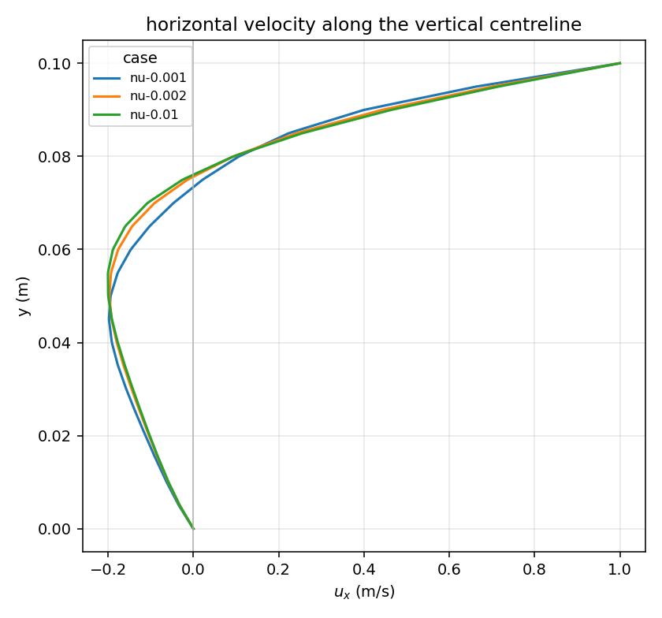
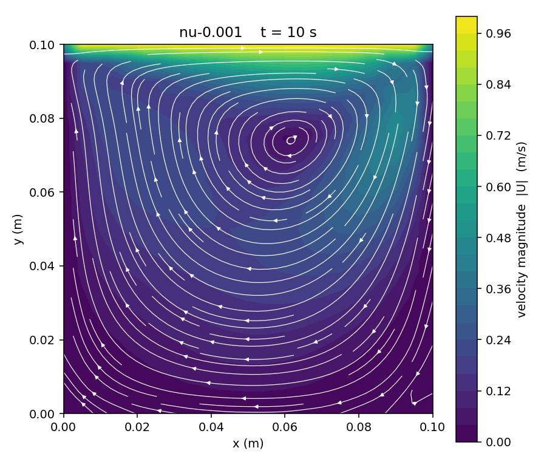

# OpenFOAM in a container on AWS Deadline Cloud

Run an [OpenFOAM](https://www.openfoam.com/) parameter sweep on Deadline Cloud, inside a container image that you build.
The queue's Docker environment runs every job action in that image, so the job template has no Docker commands.

## The cavity sweep

The job solves OpenFOAM's lid-driven cavity at three viscosities, which give Reynolds numbers 10, 50 and 100.
A `Solve` step runs one task per viscosity, then a `Plot` step compares the three cases on one graph.

```
containers/openfoam/
├── README.md               the walkthrough you are reading
├── openfoam-ubuntu/        the image: Dockerfile, the foam-plot tool and a README
└── job_bundle/             the job: template.yaml, three shell scripts and a README
```

## Prerequisites

- A Linux service-managed fleet with the Docker add-on, associated with a queue that uses the Docker default queue environment. The [user guide](https://docs.aws.amazon.com/deadline-cloud/latest/userguide/fleet-container-support.html) walks through both.
- A queue role that can pull images from Amazon ECR. The console attaches `AmazonEC2ContainerRegistryReadOnly` for you.
- A private [Amazon ECR repository](https://docs.aws.amazon.com/AmazonECR/latest/userguide/repository-create.html) named `openfoam-ubuntu`.
- Docker and the AWS CLI on an x86_64 build machine.
- The [Deadline Cloud CLI](https://github.com/aws-deadline/deadline-cloud), configured for your farm.

## Build and push the image

The steps follow [Building, tagging, and pushing a container image](https://docs.aws.amazon.com/deadline-cloud/latest/developerguide/containers-build-push.html) in the developer guide.
Set your account and Region first.

```bash
REGION=<region>
ACCOUNT_ID=<account-id>
REPOSITORY=openfoam-ubuntu
IMAGE_TAG=2512
REGISTRY="${ACCOUNT_ID}.dkr.ecr.${REGION}.amazonaws.com"
IMAGE_URI="${REGISTRY}/${REPOSITORY}:${IMAGE_TAG}"
```

Create the repository once, if you have not already.

```bash
aws ecr create-repository --region "${REGION}" --repository-name "${REPOSITORY}" \
    --image-scanning-configuration scanOnPush=true
```

Build the image from `openfoam-ubuntu/`. The build solves the cavity once and fails if the plot comes out wrong.

```bash
cd openfoam-ubuntu
docker build --platform linux/amd64 --tag "${REPOSITORY}:${IMAGE_TAG}" .
```

Check the image locally. It prints the OpenFOAM version.

```console
$ docker run --rm "${REPOSITORY}:${IMAGE_TAG}"
OpenFOAM v2512 (API 2512), tutorials under /usr/lib/openfoam/openfoam2512/tutorials
```

Push the image, then record its digest.

```bash
aws ecr get-login-password --region "${REGION}" | \
    docker login --username AWS --password-stdin "${REGISTRY}"
docker tag "${REPOSITORY}:${IMAGE_TAG}" "${IMAGE_URI}"
docker push "${IMAGE_URI}"
aws ecr describe-images --region "${REGION}" --repository-name "${REPOSITORY}" \
    --image-ids imageTag="${IMAGE_TAG}" --query 'imageDetails[0].imageDigest' --output text
```

## Submit the job

Submit the bundle from this directory, and pass the image you pushed.
Without `-p DockerImage`, the job runs in the queue environment's default image instead.

```bash
cd ..
deadline bundle submit job_bundle \
    --farm-id <farm-id> --queue-id <queue-id> \
    -p DockerImage="${IMAGE_URI}"
```

Wait for the job, then download its output.

```bash
deadline job wait --farm-id <farm-id> --queue-id <queue-id> --job-id <job-id>
deadline job download-output --farm-id <farm-id> --queue-id <queue-id> --job-id <job-id>
```

## What you get

`deadline job download-output` writes the results to `job_bundle/output/`.

```
output/
├── cases/nu-0.01/ nu-0.002/ nu-0.001/      solved cases: time directories, solver logs, VTK/
├── plots/nu-0.01-velocity.png ...          one velocity field per case
├── plots/centreline.png                    the three cases on one graph
└── summary.txt                             OpenFOAM version, and the end time and run time of each case
```

The centreline graph shows the lid dragging the top layer at 1 m/s, and a return flow of about 0.2 m/s near mid-height.
The profiles stay close, and the Re 100 case departs furthest from the others.



Each velocity plot shows one main vortex. As the Reynolds number rises, its centre moves in the direction the lid travels.



## How it works

Each action in the job template runs through a hook in the queue environment.
A `Solve` session runs the `Mesh` and `Solve` rows below, and the `Plot` step gets a session of its own.

| Job action | Queue environment action | Where it runs | Work |
|---|---|---|---|
| None | `onEnter` | Worker | Start rootless Docker, pull the image, start the session container |
| `Mesh` `onEnter` | `onWrapEnvEnter` | Container | Clone the tutorial and run `blockMesh` once |
| `Solve` `onRun`, one per task | `onWrapTaskRun` | Container | Copy the mesh, set the viscosity, solve, convert to VTK, plot |
| `Plot` `onRun` | `onWrapTaskRun` | Container | Draw the centreline graph and write the summary |
| None | `onExit` | Worker | Stop the container |

The session directory is mounted at the same path inside the container.
That keeps the bundled scripts, the mesh and `OutputDir` at the paths the template names.

The commands run without a login shell. The image sets `BASH_ENV` to load OpenFOAM in every `bash`.
The template doesn't reference the install path or any OpenJD extension.

Read more about the moving parts:

- [Run portable jobs in containers](https://docs.aws.amazon.com/deadline-cloud/latest/developerguide/containers.html) and the [Docker queue environment](https://docs.aws.amazon.com/deadline-cloud/latest/developerguide/containers-queue-environment.html) in the developer guide.
- [Share the session working directory](https://docs.aws.amazon.com/deadline-cloud/latest/developerguide/containers-share-session-directory.html) with the container.
- [RFC 0008: environment wrap actions](https://github.com/OpenJobDescription/openjd-specifications/blob/mainline/rfcs/0008-environment-wrap-actions.md), the `WRAP_ACTIONS` extension the queue environment uses.
- [RFC 0005: expression language](https://github.com/OpenJobDescription/openjd-specifications/blob/mainline/rfcs/0005-expression-language.md) and [RFC 0006: function library](https://github.com/OpenJobDescription/openjd-specifications/blob/mainline/rfcs/0006-expression-function-library.md), the `EXPR` syntax the queue environment uses to forward each command.
- [2023-09 template schemas](https://github.com/OpenJobDescription/openjd-specifications/wiki/2023-09-Template-Schemas), the syntax of `job_bundle/template.yaml`.

## Cost and cleanup

Workers bill while they run, and the fleet starts workers when jobs are waiting.
The image costs ECR storage, and job attachments and output cost S3 storage.

Delete the image repository when you finish.

```bash
aws ecr delete-repository --region "${REGION}" --repository-name openfoam-ubuntu --force
```

## Troubleshooting

| Symptom | Cause |
|---|---|
| `openjd_fail: could not pull` in the session log | The image URI is wrong, or the queue role cannot read the repository. |
| `FOAM_TUTORIALS: OpenFOAM is not loaded` | The image does not set `BASH_ENV`. Rebuild it from `openfoam-ubuntu/`. |
| `no tutorial case at ...` | The `Tutorial` parameter is not a path under `$FOAM_TUTORIALS`. |
| `mesh spans N planes in z` | The tutorial is 3D. The plots handle 2D cases only. |

Session logs are in the Deadline Cloud monitor, or run `deadline job logs --job-id <job-id>`.

## Tested with

| Item | Value |
|---|---|
| Image | OpenFOAM v2512, Ubuntu 24.04 and matplotlib 3.10.7. 1.74 GB on disk, 546 MB compressed in ECR. |
| Fleet | Linux x86_64 service-managed fleet, 16 vCPU, 32-64 GiB, CPU only, spot, Docker add-on |
| Deadline Cloud CLI | 0.60.7 |
| Result | 4 of 4 tasks succeeded in 4 sessions on 3 workers, 94 seconds from job start to finish |
| Timing | Image pull 28-42 seconds per new worker. Each `Solve` task took 5-8 seconds and `Plot` took 5 seconds. |

## Related resources

- [OpenFOAM](https://www.openfoam.com/) from OpenCFD.
- [`openfoam-ubuntu/README.md`](openfoam-ubuntu/README.md) for what the image contains.
- [`job_bundle/README.md`](job_bundle/README.md) for the job's parameters and scripts.
