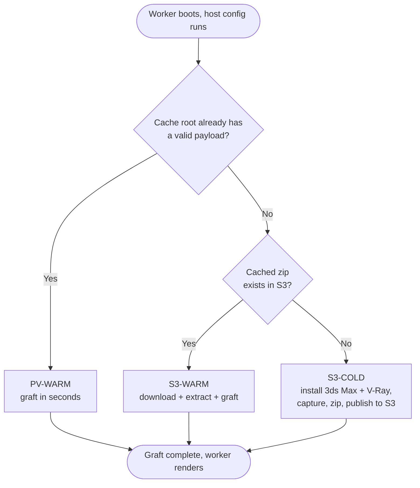

# 3ds Max 2026 + V-Ray 7 host configuration (S3-cached, persistent-volume accelerated)
This host configuration installs 3ds Max 2026 and V-Ray 7 for 3ds Max 2026 on AWS Deadline Cloud
Windows service-managed fleet workers. Unlike the standard scripts, it installs only once. The
result is captured to S3 and reused on every later worker rather than reinstalled. A fleet persistent
volume is an optional accelerator on top of the S3 cache.

It was validated on a service-managed fleet with V-Ray 7.00.08 (V-Ray 7, Hotfix 2). A cold boot took
38 minutes of the 60-minute host configuration limit, a restore from S3 took about 4 minutes, and a
worker that reattached its persistent volume finished host configuration in 18 seconds. V-Ray
licensing comes from the fleet, and the script does not touch it.

The caching mechanism is the same as the
[Pencil+ persisted cache sample](../3dsmax-2026-pencilplus-persistent/README.md). This README covers
what differs for V-Ray. 3ds Max 2026 is not affected by the 3ds Max 2027 Autodesk ADP
"Failed to start" issue, so no ADP workaround is needed here.
## Files
| File | Purpose |
|---|---|
| [`s3-hosted-3dsmax-2026-vray-persistent.ps1`](s3-hosted-3dsmax-2026-vray-persistent.ps1) | The full host configuration script. On a cold boot it installs 3ds Max 2026 + V-Ray and captures the payload. On warm boots it grafts that payload. |
| [`s3-bootstrap-loader.ps1`](s3-bootstrap-loader.ps1) | An inline loader that downloads and runs the full script from S3. Use it because the full script exceeds the 15,000-character inline `scriptBody` limit. |
| [`render_test/`](render_test/) | A job bundle that builds a V-Ray scene with MAXScript and renders it with `3dsmaxbatch.exe` as the job user. It is the render the validation ran. See [Verifying](#verifying). |
The `s3-hosted-` prefix marks a script that is fetched from S3 at boot rather than pasted into the
fleet, so the 15,000-character limit applies to the loader beside it. Repository validation keys the
exemption off that prefix.
## Prerequisites
- The fleet's `scriptTimeoutSeconds` set to 3600, which is the service maximum. A cold boot took 38
  minutes in validation, so the 300-second default kills the worker part-way through.
- AWS CLI v2 on the worker, already present on Deadline Cloud service-managed fleet workers.
- An S3 bucket hosting the 3ds Max 2026 installer zip and the V-Ray for 3ds Max 2026 installer
  executable. Create the 3ds Max zip following the guide in the parent
  [README](../README.md#creating-a-3ds-max-installer-archive-in-zip-format).
- V-Ray 7 for 3ds Max 2026 from [Chaos](https://www.chaos.com/). Cloud rendering rights for both
  3ds Max and V-Ray are yours to confirm against the terms Autodesk and Chaos provide.
- A V-Ray license source. On a service-managed fleet that is the fleet's own usage-based
  licensing, which needs nothing from this script. See [V-Ray licensing](#v-ray-licensing).
- A fleet IAM role whose trust policy allows `credentials.deadline.amazonaws.com` to assume it.
  Workers assume the fleet role before they report `STARTED` or start remote logging, so a role
  that Deadline Cloud can't assume shows up as workers that stay in `CREATED` with no CloudWatch
  output and are then deleted. The host configuration never runs.
- A fleet IAM role with `s3:GetObject` on the installers, plus `s3:GetObject`, `s3:PutObject`,
  `s3:DeleteObject`, and `s3:ListBucket` on the cache prefix (`$S3_CACHE`, such as
  `s3://your-bucket-name/DeadlineCloud/pv-cache/3dsmax-2026-vray/*`). `s3:ListBucket` goes on the
  bucket rather than the prefix. Without it S3 answers a missing key with `403` instead of `404`, so
  the script treats `403` as "no cached payload yet" and cold installs. Once the zip exists,
  `HeadObject` returns it regardless of listing permission. `s3:DeleteObject` cleans up the temporary
  upload key a publish writes before moving the zip into place. The 7.6 GB zip is over the 5 GB
  point where `aws s3 mv` becomes a multipart copy, which by default also calls
  `s3:GetObjectTagging`. The publish passes `--copy-props none`, so the role can do without it.
- An S3 lifecycle rule on the cache prefix with `AbortIncompleteMultipartUpload` set to a day or
  two. A worker terminated mid-publish can leave an orphaned multipart upload that is billed but
  invisible to `aws s3 ls`.
## Setup
1. Stage the installers in S3 under your own bucket and prefix:
   ```console
   aws s3 cp 3ds-max-2026.zip s3://your-bucket-name/path/to/3ds-max-2026.zip
   aws s3 cp vray_adv_70008_max2026_x64.exe s3://your-bucket-name/path/to/vray_adv_70008_max2026_x64.exe
   ```
   The V-Ray filename is an example. Use the name of the file you downloaded from Chaos. The
   installer basename becomes part of the cache key (see
   [Changing the V-Ray build](#changing-the-v-ray-build)).
2. Set the `TODO` URIs at the top of `s3-hosted-3dsmax-2026-vray-persistent.ps1`:
   `$3DS_MAX_INSTALLER_ZIP_S3_URI`, `$VRAY_FOR_3DSMAX2026_INSTALLER_EXE_S3_URI`, and `$S3_CACHE`.
3. Upload the full script to S3, outside the cache prefix:
   ```console
   aws s3 cp s3-hosted-3dsmax-2026-vray-persistent.ps1 s3://your-bucket-name/DeadlineCloud/host-config/s3-hosted-3dsmax-2026-vray-persistent.ps1
   ```
4. Set `$HC_SCRIPT_S3_URI` in `s3-bootstrap-loader.ps1` to that object.
5. Paste `s3-bootstrap-loader.ps1` as the fleet's inline host-configuration script, set the timeout
   to 3600 seconds, and save.
6. Grant the fleet IAM role `s3:GetObject` on the script object and the installers, plus
   read/write on the cache prefix.
To update the host configuration later, re-upload the full script to S3. No fleet configuration
change is needed. Version or pin the object: a missing or broken object fails every worker's
boot, so treat updates to it with the same care as the fleet configuration.
## Configuration reference
Set these at the top of `s3-hosted-3dsmax-2026-vray-persistent.ps1`:
| Variable | Meaning |
|---|---|
| `$3DS_MAX_INSTALLER_ZIP_S3_URI` | The 3ds Max 2026 installer zip. Recorded in the state file, so changing it invalidates a worker's local cache. |
| `$VRAY_FOR_3DSMAX2026_INSTALLER_EXE_S3_URI` | The V-Ray for 3ds Max 2026 installer executable. Its basename is part of the cache key. Leave blank to skip V-Ray, which also drops the `C:\Program Files\Chaos` junction and the V-Ray checks. |
| `$S3_CACHE` | Prefix the payload zip is published under. Keep it separate from other samples' cache prefixes. |
| `$LOCAL_CACHE_ROOT` | Cache root used when the fleet has no persistent volume. Defaults to `C:\DeadlineCache`. It must not contain spaces, because the V-Ray installer's config file is written under it and the installer argument is unquoted. A bare drive letter works only if that drive exists on the worker. |
| `$CACHE_GENERATION` | Part of the cache key. Bump it to rebuild the payload farm-wide. Always bump it when either installer URI changes or when you change how the script installs, captures, or grafts the payload: the key carries only the generation and the V-Ray basename, and the state file records the installer URIs but not the script logic, so without a bump workers either graft a stale payload or restore the old zip only to reject it and cold install. |
The payload zip is published at
`$S3_CACHE/gen-<CACHE_GENERATION>/vray-<installer basename>/pv-payload.zip`, such as
`.../3dsmax-2026-vray/gen-1/vray-vray_adv_70008_max2026_x64/pv-payload.zip`.

To rebuild the farm-global payload for any reason, bump `$CACHE_GENERATION`:
```powershell
$CACHE_GENERATION = "2"
```
Every worker converges on the new key and none of them deletes anything. Delete the old `gen-*`
prefix once the new generation is in service.

The adaptor (`deadline-cloud-for-3ds-max`) is installed on the cold path and travels in the
cached payload, so warm boots reuse the cached version rather than reinstalling from PyPI. To
move to a newer adaptor, bump `$CACHE_GENERATION` so a fresh cold install picks it up.
### Changing the V-Ray build
Point `$VRAY_FOR_3DSMAX2026_INSTALLER_EXE_S3_URI` at the new installer under a new filename. A new
basename is a new cache key, so the first worker cold installs and publishes under it, and later
workers restore it. The old object is left in place. A worker whose persistent volume holds the old
build rejects it, because the state file records the full installer URI, the basename, and the key,
and restores the new zip instead. Both halves were exercised on a fleet.

Reusing the same filename at a new URI also invalidates local caches, but the S3 key does not change.
A worker then restores the old zip, rejects it, cold installs, and republishes over it, which costs
a download on top of a full cold boot. Bump `$CACHE_GENERATION` in that case.
## V-Ray licensing
The script leaves V-Ray licensing to the fleet. A service-managed fleet with V-Ray usage-based
licensing sets two Machine environment variables: `VRAY_AUTH_CLIENT_FILE_PATH=/null` and
`VRAY_AUTH_CLIENT_SETTINGS=licset://<endpoint>:30304`. The script never writes either variable,
never writes a `vrlclient.xml`, and never runs `setvrlservice`. The installer's `REMOTE_LICENSE=1`
value matches the other V-Ray samples and had no measurable effect.

The standalone 2025 and 2027 V-Ray samples run `setvrlservice -cloud-server=0` on every boot to work
around the Cloud Licensing change in V-Ray 7.30.02. V-Ray 7.00.08 predates that change and rendered
licensed without it, so this script omits it. Re-measure before using a 7.30.02 or later build.

A licensing failure is loud. V-Ray logs `Could not obtain a license` and doesn't write an image,
rather than rendering with a watermark. Each boot logs whether the two variables are set:
`V-Ray licensing: VRAY_AUTH_CLIENT_SETTINGS is set by the fleet`.
## V-Ray side effects
The V-Ray 7.00.08 installer was measured with a before/after diff of the registry, services,
drivers, environment, scheduled tasks, firewall, certificates, and the file system. It also installs
Chaos Scatter 6.2 for 3ds Max 2026, which is cached with V-Ray.
| Side effect | Handling |
|---|---|
| `C:\ProgramData\Autodesk\ApplicationPlugins\VRay3dsMax2026\` (the 3ds Max plugin bundle) and `...\ChaosScatter3dsMax2026\` | Cached through the existing `C:\ProgramData\Autodesk` junction. |
| `C:\Program Files\Chaos\V-Ray\3ds Max 2026\` (`INSTALLROOT`: `mdl`, `lib`, `utils`, the installer log) and `C:\Program Files\Chaos\Scatter\` | Cached through a `C:\Program Files\Chaos` junction, created only when V-Ray is configured. |
| `HKLM\SOFTWARE\Classes\.vrmat`, `.vismat`, `.vrscan`, and the thumbnail handler `CLSID\{7E3BE910-47ED-4640-8DC0-F984C41BBDEF}` | Exported into the registry graft and imported on every warm boot. Explorer thumbnails only, but they cost nothing to carry. |
| `HKLM\...\Uninstall\Chaos Scatter for 3ds Max 2026` | Exported and imported the same way. |
| `VRAY_FOR_3DSMAX2026_MAIN`, `VRAY_FOR_3DSMAX2026_PLUGINS`, `VRAY_MDL_PATH_3DSMAX2026` | The installer sets none of them, and the adaptor requires all three. Set as Machine variables on every boot path, with the same values as the standalone V-Ray samples. |
| `VRAY_SEND_ANONYMIZED_FEEDBACK=0` and `VRAY_SEND_PERSONALIZED_FEEDBACK=0` in the installing user's (SYSTEM) hive | Left out, since they never reach the job user on a cold boot either. |
| `HKLM\SYSTEM\CurrentControlSet\Control\GraphicsDrivers\TdrDelay=8` | Left out, since it is a GPU timeout and CPU renders passed without it. |
| `C:\Program Files\Common Files\ChaosGroup\chaos_installs_cleanup.log`, an empty `C:\null\` | Left out of the capture, since V-Ray recreates `C:\null` at render time, because `VRAY_AUTH_CLIENT_FILE_PATH=/null` resolves there. |
| Bundled VC++ 2015-2022 redistributable | Nothing to do. The worker image already has a newer runtime, so it exits `0x666` and the overall install still exits 0. |
| Services, `HKLM\SOFTWARE\Chaos Group`, `HKLM\SOFTWARE\Chaos`, pending file renames | None created. |
A grafted worker with none of the left-out items rendered licensed V-Ray as both SYSTEM and the
job user.

The install itself uses the same DefValues XML, `-gui=0 -configFile=... -quiet=1` switches, and log
banners as [`3dsmax-2027-and-vray.ps1`](../3dsmax-2027-and-vray.ps1). It differs in three ways,
because a failed install here would be published to the whole farm. It checks the installer exit
code. It checks the plugin bundle (`Assert-VRayBundle`): `PackageContents.xml` parses and lists a
`vrender*.dlr`, every listed module exists, and `bin\vray.dll` and at least one
`bin\plugins\vray_*.dll` are present. It also checks the `mdl` library. The bundle check runs after
the install, on the payload before every publish, and through the live load path after every graft.
## Verifying
Set the fleet's minimum worker count to 1 and review the worker's CloudWatch logs
(`/aws/deadline/farm-<farm-id>/fleet-<fleet-id>`). Confirm the boot path line, such as
`=== S3-WARM boot: restoring cache root from S3 zip ===`, the `V-Ray licensing: ... set by the fleet`
lines, and `exit code: 0`. The first worker performs the cold install and publishes the zip. Later
workers restore from it.

Then render a V-Ray scene. Treat a missing image or a `Could not obtain a license` line as a failure.
The [`render_test/`](render_test/) bundle does this without a stored scene. `make_scene.ms` resets
3ds Max, builds a teapot with a `VRayMtl`, a `VRayLight`, and a camera, and saves it.
`render_scene.ms` renders it at 640x360. `run.ps1` runs both through `3dsmaxbatch.exe`, copies the
logs and the image to the job output, and fails the task unless both exits are 0, the image exists,
the V-Ray log has no `error:` line, and no log has `Could not obtain a license`. Submit it to a queue
that uses this fleet:
```console
deadline bundle submit render_test --parameter Tag=first-boot
deadline job download-output --job-id <job-id>
```
The task log ends with `P4 VERDICT: PASS` or `P4 VERDICT: FAIL`, followed by the counts it checked.

The [`sunflower_sphere`](../examples/sunflower_sphere/) bundle also works, with one known error. It
was saved in 3ds Max 2025 and points at the 3ds Max 2025 OCIO configuration. On 2026, V-Ray logs one
color-management error and `3dsmaxbatch` exits `-130`, although the image is still written.
## Validation
Measured on a Windows service-managed fleet (8 to 32 vCPU, 32 to 64 GiB, on-demand, CPU only) with a
500 GiB persistent volume at 3000 IOPS and 250 MiB/s, and
`scriptTimeoutSeconds` of 3600. Each boot was followed by the [`render_test/`](render_test/) job, which
ran `3dsmaxbatch.exe` directly as the job user, using the 3ds Max 2026 default OCIO configuration.
Before the script was written, the installer's side effects were measured on a fleet worker, and a
warm boot was simulated there by removing the install from `C:` and grafting it back from the
persistent volume. The grafted install rendered licensed V-Ray as both SYSTEM and the job user.
| Path | Boots | Host configuration time | Breakdown |
|---|---|---|---|
| S3-COLD | 2 | 38m 18s and 37m 57s of 60m | installer download 1m31s to 1m32s, extract 1m08s, 3ds Max Setup 10m45s to 11m35s, V-Ray install 38s to 41s, zip create 20m36s to 21m02s, upload 43s to 51s |
| S3-WARM | 4 | 4m 08s to 4m 30s | zip download about 1m55s, extract about 2m, then graft |
| PV-WARM | 1 | 18s | graft 10s, including the render checks |
Every render exited 0. Every V-Ray log reported `0 error(s), 0 warning(s)`, and no log contained a
license or watermark line. The images from the seven boots were viewed, and none had a watermark. An earlier negative
control on the same fleet pointed `VRAY_AUTH_CLIENT_SETTINGS` at a closed port. It failed with
`Could not obtain a license` and didn't write an image, so an image without that line is a licensed
render.

The payload zip is 7.6 GB, and creating it is over half of the cold path. That sets the margin
against the 60-minute limit: the slower cold boot had about 21 minutes left. A heavier payload, more
plugins, or a slower volume eats into it first.

The version-change test reused the 7.00.08 bytes under a second filename. The cold boot went to the
new key and left the original object untouched. Restoring the original filename then rejected a
persistent volume that held the second build's state and restored the original zip.
## Limits and unverified items
- One V-Ray build was measured, 7.00.08. A newer build can have different side effects, in
  particular the Cloud Licensing change in 7.30.02.
- CPU rendering only. GPU rendering and the `TdrDelay` value were not tested.
- The V-Ray install root is fixed at `C:\Program Files\Chaos\V-Ray\3ds Max 2026`. The
  `$VRAY_FOR_3DSMAX2026_INSTALL_ROOT` variable feeds the installer, but the payload checks look for
  V-Ray at the default path. Any other value makes every publish fail with a
  `WARNING: S3 publish failed (non-fatal)` line, and every boot then installs cold.
- Validation renders called `3dsmaxbatch.exe` directly. Rendering through the 3ds Max adaptor was not
  part of the validation, though the adaptor is installed and its three V-Ray variables are set.
- Whether the job user was a local Administrator on the measured boots was not checked, so rendering
  as a non-administrator job user is unverified.
- Not exercised on a fleet: seeding the S3 zip from a persistent volume when the zip is absent,
  two or more workers cold installing at once, the republish after a failed restore, and a 3ds Max-only
  configuration with the V-Ray URI left blank.
- State rejection was observed in one direction: a volume holding the second filename's state,
  booted with the original filename. The opposite direction runs the same comparison.
- The boot log does not print the cache key, and it does not say why it rejected a local state file.
  Check the S3 object path to see which key a worker used.
## Troubleshooting
`V-Ray installer exited <code>`
The installer failed. The log prints the last 20 lines of
`C:\Program Files\Chaos\V-Ray\3ds Max 2026\uninstall\install.log` above this line. Check that the
installer is the 3ds Max 2026 build.

`after V-Ray install: ...`, `payload: ...`, or `load path: ...`
`Assert-VRayBundle` found the plugin bundle incomplete: a missing or invalid `PackageContents.xml`, a
missing listed module, or a missing `bin\vray.dll` or `bin\plugins\vray_*.dll`. The prefix tells you
which check failed. `after V-Ray install` runs straight after the installer, `payload` runs before a
publish, and `load path` runs through `C:\ProgramData\Autodesk` after a graft.

`V-Ray env <name> does not resolve`
One of the three `VRAY_*2026` Machine variables points at a path that does not exist after the
graft. The payload or the junctions are incomplete. Bump `$CACHE_GENERATION` to rebuild.

`V-Ray config path '...' contains whitespace`
`$LOCAL_CACHE_ROOT` or the persistent volume mount contains a space. Use a path without one.

`reg export WOW Autodesk failed (1): ...`
The capture treats both the 64-bit and 32-bit Autodesk registry keys as mandatory. A 3ds Max 2026
install writes both. If a later 3ds Max stops writing `HKLM\SOFTWARE\Wow6432Node\Autodesk`, switch
that `reg.exe export` call in `Export-InstallerState` to `Export-RegKey`, which skips an absent key.

Permissions mistakes on the cache prefix fail without announcing themselves, so check the fleet
role before looking at the script. A missing `s3:PutObject` shows as every boot taking the cold path
with a `WARNING: S3 publish failed (non-fatal)` line and an empty cache prefix. A missing
`s3:GetObject` on the cache prefix shows as every boot taking the cold path with no warning, and a
cache object whose `LastModified` keeps advancing.
## Appendix: boot paths and cache tiers
The install is always reached through NTFS junctions, so the payload can live on the fleet's
persistent volume or a local disk. On boot the script picks one path:

| Boot path | When it runs | What happens |
|---|---|---|
| S3-COLD | This generation and V-Ray installer key have no cached zip yet | The worker runs the real 3ds Max and V-Ray installers. The registry, services, licensing, and .NET state are captured into a zip and published to S3. Normally happens once per version, farm-wide. |
| S3-WARM | A cached zip exists in S3 | Download and extract the payload into the cache root (any Availability Zone, with or without a persistent volume), then graft. |
| PV-WARM | An earlier boot left a valid payload in the cache root, whether that is the persistent volume or `C:\DeadlineCache` | Skip the download and graft in seconds. |
The zip payload contains `Software\`, `SoftwareData\`, and `SoftwareRegistry\`. V-Ray is stored in
two of them:

| Live path | Payload path |
|---|---|
| `C:\ProgramData\Autodesk\ApplicationPlugins\VRay3dsMax2026` | `SoftwareData\Autodesk\ApplicationPlugins\VRay3dsMax2026` |
| `C:\Program Files\Chaos\V-Ray\3ds Max 2026` | `Software\Chaos\V-Ray\3ds Max 2026` |
`.install-state.json` lives inside `SoftwareRegistry\` and records the 3ds Max installer URI, the
V-Ray installer URI and basename, the cache key, and the generation. A local payload is used only
when all of them match the script and the key payload files are present.

Some content appears twice in the zip, because tar follows the two `Current` version junctions a
3ds Max install leaves under `Software\`, which the script logs as a warning on every publish.

The script doesn't coordinate between workers. Workers that boot cold in the same window each run
their own install, matching what the standard non-caching scripts do on every boot. Whoever finishes
last then checks S3 and skips the upload if a zip is already published. A lock would save those
duplicate installs, but it needs a wait-and-poll path that fails a boot outright whenever it misjudges
a live installer as dead.

`SoftwareData\FLEXnet` holds the Autodesk licensing trusted-storage, and every worker restoring the
payload receives the copy captured by whichever worker published it. Watch for licensing that works
on the publishing worker and fails elsewhere, and drop `FLEXnet` from the capture if your licensing
setup needs per-host state. V-Ray licensing does not use it.
## Appendix: security and trust
The cache prefix is a code-distribution channel, not just a file store. On every warm boot the
script runs as SYSTEM. From the cached zip it imports registry files and registers services, and
it copies files into `C:\Program Files`. Anyone who can write to the cache prefix or to the script
object that `s3-bootstrap-loader.ps1` downloads can run code as SYSTEM on every worker that boots
afterward, farm-wide.

Workers write the cache prefix at runtime and never write the loader's script object, so each one
needs different permissions.
- Grant `s3:PutObject` on the cache prefix to the fleet role alone. Workers publish `pv-payload.zip`
  themselves, so the fleet role has to write here. A compromised worker that gains persistent SYSTEM
  across the fleet is a residual risk of this caching design rather than something the permissions
  can remove. Use a bucket policy with `aws:SourceArn` or `aws:SourceAccount` conditions, and enable
  S3 Block Public Access.
- Keep `s3:PutObject` on the loader's script object with your deployment or administrator
  principal only. The fleet role needs `s3:GetObject` and must not have `s3:PutObject` here, so
  host the script outside the cache prefix.
- Do not share the prefix across farms or with any principal that should not run code as SYSTEM.
- Enable bucket versioning on the prefix so a bad or tampered object can be rolled back.
- Record a SHA-256 of the published zip somewhere the fleet role cannot write, and verify it
  after download, when you want provenance rather than only access control.

The script sets an explicit ACL on one directory, `SoftwareRegistry\`, granting SYSTEM and
Administrators only. That tree holds the `graft\` directory of `.reg` files and the
`.install-state.json` gate. `Import-InstallerState` runs `reg import` over everything in `graft\` as
SYSTEM on every boot, and `.install-state.json` steers which boot path runs, so a file the job user
could add or forge there would become SYSTEM-level registry content. Everything else keeps its
inherited ACL, which already denies the job user modifying or deleting existing files.

`SoftwareData\Autodesk\ApplicationPlugins` is archived rather than excluded, and it has to be. It holds
MAXtoA, the Arnold renderer 3ds Max uses by default, and the V-Ray and Chaos Scatter bundles. The
directory is writable by the job user, so a dropped `.bundle` can reach the published zip through
whichever worker seeds it. That exposure is accepted deliberately, because the alternative is a
cached 3ds Max that cannot render. `Test-PayloadComplete` refuses to publish a payload with no
`maxtoa.dlr` or an incomplete V-Ray bundle, and every publish logs the bundles it archives.

The job user can still create new files in the payload directories, so a DLL placed beside a 3ds Max
executable could be loaded by a later render. A persistent volume is not wiped between boots, so such a
file stays there. The seed path then publishes it to the whole farm. Check the mount's own ACL when
you attach a volume: the script assumes rather than verifies that the root is not writable by the job
user.
