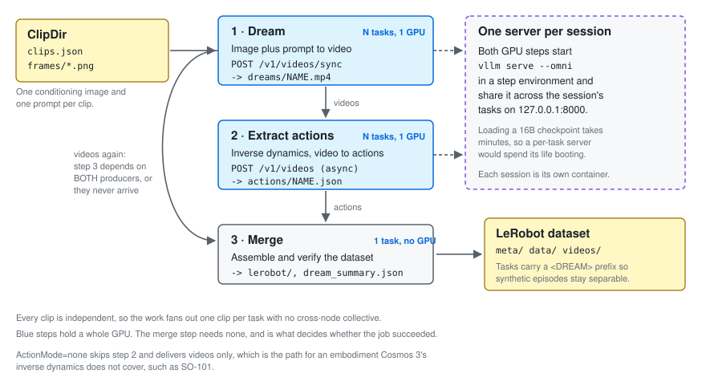
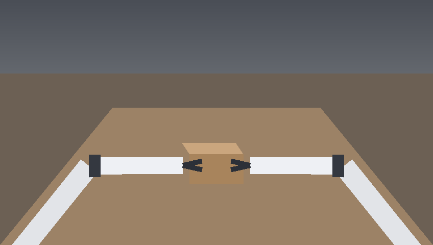
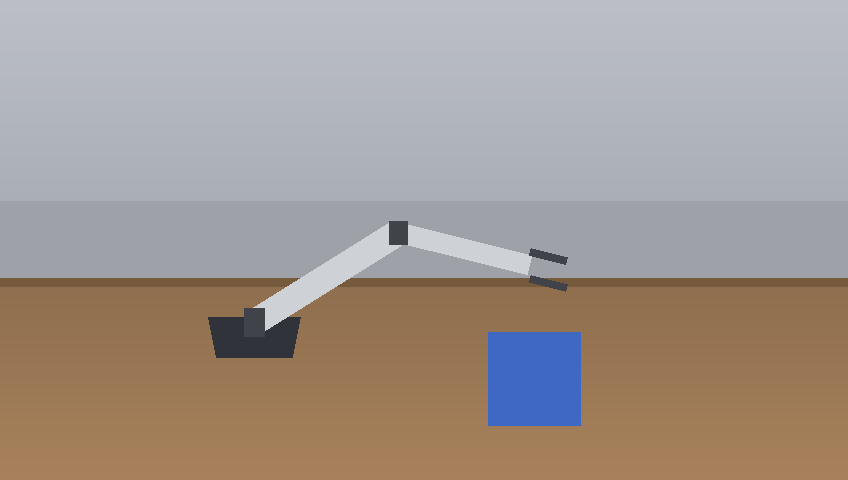

# Cosmos 3 dream trajectories

Turn conditioning images and language prompts into synthetic robot videos with NVIDIA Cosmos 3,
optionally recover the action trajectory for each video, and merge the results into a
LeRobot-layout dataset. One Deadline Cloud task handles one clip.



This follows the NVIDIA DreamGen pipeline. A world model generates the video, an
inverse-dynamics model recovers the actions, and the result joins a real teleoperation
dataset. Deadline Cloud suits the generation half because each clip is independent and needs
no communication between workers. It does not suit the training half, which wants EFA and
NCCL across nodes. See [Work that belongs elsewhere](#work-that-belongs-elsewhere).

Read [Embodiment coverage](#embodiment-coverage) before you choose `ActionMode`. Video
generation works for any embodiment. Cosmos 3's inverse dynamics accepts only a fixed list,
so the default scene uses Agibot, which is on it. SO-101 is not, and the sample includes a
scene and a documented path for that case.

## What you get

* **Dependent fan-outs with a verifying merge.** Generation and action recovery are separate
  steps over the same `parameterSpace`, which lets either be re-run alone. The merge decides
  whether the job succeeded.
* **One model server per session, shared by that session's tasks.** Both GPU steps start
  `vllm serve --omni` in a step environment. Loading a 16B checkpoint takes minutes, so a
  per-task server would spend almost all its time starting up. This pattern comes from the
  [daemon-process environment](../job_env_daemon_process/) sample.
* **A bundle that specifies no container image.** All Docker handling belongs to the queue
  environment. The template also runs under `openjd run` on any host that has vLLM-Omni.
* **Guards that check artifacts rather than exit codes.** Each step verifies what it wrote.
  See [Step guards](#step-guards).
* **A worker-side capability check.** A service-managed fleet reports neither GPU memory nor an
  accelerator name as a capability, which leaves `hostRequirements` unable to request a
  48 GB GPU. The
  step environment reads the GPU it received and either adapts or fails.

## Prerequisites

| Requirement | Detail |
|---|---|
| Fleet | Linux, the `docker` software add-on, one GPU per worker, and a `persistentVolumeConfiguration` for the weight cache. An `l40s` (48 GB) keeps the model in GPU memory. A 24 GB `l4` or `a10g` needs layerwise offload, which costs host RAM. |
| Infrastructure | [`cloudformation/.../gpu_docker_persistent_farm`](../../cloudformation/farm_templates/gpu_docker_persistent_farm/) deploys the farm, queue, fleet, roles and association. |
| GPU quota | Zero in a new account. Raise the EC2 G and VT quota for On-Demand and for Spot separately before you deploy. See [Request GPU quota first](../../cloudformation/farm_templates/gpu_docker_persistent_farm/README.md#request-gpu-quota-first). |
| Queue | A Docker queue environment. Use [`queue_environments/docker_queue_env.yaml`](../../queue_environments/docker_queue_env.yaml). |
| Container image | Mirror `vllm/vllm-omni:cosmos3` into ECR. The queue environment accepts ECR registries only, as the console-generated one does. See [Mirror the image](#mirror-the-image). |
| Queue `jobRunAsUser` | Leave it unset so actions run as the worker-agent user. The Docker add-on prepares a rootless daemon for that user, and a different user cannot use the Docker socket. |
| Host configuration | None. The add-on installs rootless Docker, the NVIDIA Container Toolkit and the CDI spec. |
| Worker disk | A 300 GiB root volume for the container image, and a persistent volume of at least 250 GiB for the 35 GB checkpoint. |
| Hugging Face token | Required. See [Model access](#model-access). |
| Local tools | `openjd-cli` 0.8 or newer, because 0.7.x rejects the queue environment's `WRAP_ACTIONS` and `EXPR` extensions, and the `deadline` CLI to submit. |

### Model access

A Hugging Face token is required even though `nvidia/Cosmos3-Nano` itself is ungated.
vLLM-Omni loads `nvidia/Cosmos-1.0-Guardrail` at startup, and that repository is gated under
the NVIDIA Open Model License. Accept its terms, store the token in Secrets Manager as
plaintext, and pass the ARN as the queue environment's `HfTokenSecretArn`.

Store the token as plaintext rather than JSON. A value saved through a console field often
arrives wrapped in double quotes. Those quotes arrive in the Authorization header, and Hugging
Face answers `Invalid username or password`, which says nothing about quoting. The `onEnter` strips quotes and whitespace, then requires an
`hf_` prefix. A malformed secret fails at session start rather than mid-job.

## Job attachments and step dependencies

Each of these produced a job where every GPU task reported `SUCCEEDED` and the final step
failed on missing inputs. Neither is visible to `openjd check`, and each costs a full GPU run
to find.

**A step's dependencies are its download list, not only its ordering.** The worker runs a
second attachments download, logged as `Job Attachments Download for Step`, which fetches the
outputs of the steps this step depends on. That download covers direct dependencies only, not
the transitive closure. `3 - Merge` lists both producers:

```yaml
  dependencies:
  - dependsOn: 1 - Dream
  - dependsOn: 2 - Extract actions
```

Listing `2 - Extract actions` alone is the intuitive choice and it does not work. Step 2 reads
the videos and writes only action JSON, which leaves the videos out of its own uploads. The
merge session then has `actions/` and no `dreams/`. In the session log that step download was
6 files totalling 13.5 KB, against clips of about 320 KB each.

**An empty input directory is never uploaded.** `OutputDir` is `dataFlow: INOUT`, so each
task's copy includes its peers' uploads. If the directory is empty at submit time, the
submitter prints:

```text
Input directory '/path/to/cosmos3-out' is empty. Adding to referenced paths.
```

A referenced path is mapped but never synced, which stops any step's outputs from arriving
anywhere else. Put a file in the directory before submitting, and check that the submitter
lists it under "Locations for upload":

```console
mkdir -p ~/cosmos3-out && touch ~/cosmos3-out/.keep
```

## The Docker queue environment

A model server shared by a session's tasks sounds incompatible with a Docker queue
environment, because the server and the tasks look like they run in different containers. They
do not. The queue environment's `onEnter` starts one container whose PID 1 is a sleep loop and
publishes its id. Every wrapped action is then:

```bash
docker container exec --user 0:0 "$DOCKER_CONTAINER_ID" ...
```

into that same container. All of a session's actions, including the step environment's
`onEnter` and `onExit`, use one filesystem, one process namespace and one network namespace.
A `vllm serve` started in `onEnter` answers on `127.0.0.1:8000` for every task in that
session, and `onExit` can signal it by pid.

The consequences the sample relies on:

A fixed port is safe. Each session gets its own container and its own network namespace, so
sessions cannot collide on a port.

The image's `ENTRYPOINT` never runs. Actions are `exec`ed into a container that is already
running, which leaves the job to do whatever an entrypoint would have done. The step
environment invokes `vllm serve` for that reason.

Actions run as container root, which a rootless userns maps to the host's job user. Files
written into the bind-mounted session directory belong to the job user, so job attachments can
upload them. Container root also exists in every image, which keeps `getpass.getuser()`
working.

The GPU arrives through CDI. The add-on installs the NVIDIA Container Toolkit, generates
`/etc/cdi/nvidia.yaml` at boot and enables the daemon's `cdi` feature. It does not register
the rootful `nvidia` runtime, whose prestart hook needs a `CAP_MKNOD` that a rootless daemon
lacks. The queue environment tests for the spec file and passes `--gpus all`. The trap is the
gate rather than the flag. Testing `docker info` for an `nvidia` runtime is the rootful idiom,
it is false here, and then no GPU flags are passed at all. The container runs CPU-only and the
workload fails minutes later with a CUDA error unrelated to the cause.
`serve_cosmos3.sh` runs `nvidia-smi` inside the container before loading the model.

Every action on the queue is wrapped, with no per-step opt-out. The merge step runs inside the container even though it
uses only the CPU and leaves the server idle.

### Why generation and action recovery are separate steps

One step could do both per clip and start only one server. It is split for three reasons.

They fail for different reasons. A generation failure means a bad prompt, a bad conditioning
image, or a guardrail rejection. An action failure almost always means a wrong `DomainName` or
`RawActionDim`.

Re-running step 2 with a different embodiment setting costs one step rather than the whole
dataset.

Step 2 is close to an inverse-dynamics labelling job for real footage, though not one yet. It
locates its input through the `dreams/NAME.json` summaries that step 1 writes, so real video
needs either those summaries synthesized or that lookup replaced.

The cost is a second server start, because a dependent step is a new session and a
new container.

### Weight caching

The checkpoint is about 35 GB and each GPU step is a separate session, which makes a two-step
job download it twice without a cache.

The queue environment caches it on the fleet's persistent volume. It bind-mounts
`<PersistentVolumeMountPath>/<ModelCacheSubdir>` into the container at the same path and
exports it as `HF_HOME`. Rootless Docker keeps its image store under the job user's home,
which that volume also re-homes, so the container image is cached the same way.

**How much this saves, measured rather than assumed.** Sessions landing on a worker that is
already up reused both caches, with the checkpoint present in the weight directory and the
Docker pull reporting `Image is up to date`. A job submitted after the fleet had scaled to zero got a
**fresh, empty volume**: the 10.8 GB image re-pulled over about 320 seconds and the 35 GB
checkpoint downloaded again, despite `lastUsedTtlHours` being 168. The cache helps a busy fleet and does
nothing for the first job after an idle period. Service-managed volumes are not
visible in your account, so whether that is caused by scale-to-zero or by the replacement
worker landing in another Availability Zone is untested. Budget for a cold start on the first
job of the day.

This degrades quietly instead of failing in two places.

The mount paths disagree. The queue environment's `PersistentVolumeMountPath` has to match the
fleet's `persistentVolumeConfiguration.mountPath`. On a mismatch the queue environment warns,
falls back to a session-local cache, and the job still succeeds while paying the download
twice.

`lastUsedTtlHours` expires. The service default is 12 hours. An idle night deletes the volume
and its cache. The CloudFormation sample sets 168.

`serve_cosmos3.sh` logs which cache it used. The session log confirms which one applied.

### Which endpoint, and why

`POST /v1/videos/sync` returns the MP4 in the response body. `POST /v1/videos` returns a job id
to poll. Inverse dynamics reports through the async endpoint because its result is an action
array rather than a video. The sample uses both endpoints. The
[Cosmos3-Nano model card](https://huggingface.co/nvidia/Cosmos3-Nano) documents both calls.

vLLM-Omni is not interchangeable either. Action generation exists only there. SGLang's
Cosmos 3 support states that action generation is unsupported, and the Diffusers pipeline
generates video only.

## Embodiment coverage

Cosmos 3 generates video for anything you condition it on. Its inverse dynamics accepts a
fixed set of embodiments, documented on the model card as general camera motion 9D,
autonomous vehicle 9D, egocentric motion 57D, single Franka Panda with RobotiQ gripper 10D,
dual Franka Panda 20D, Agibot 29D, UR 10D, Google robot 10D, WidowX 250 10D and UMI 9D.

SO-101 and SO-100 are absent from that list, and no parameter changes it. Running inverse
dynamics on SO-101 footage returns a trajectory in another embodiment's action space:
plausible numbers that no SO-101 can execute, in a file that resembles a dataset.

Each scene in this sample does a different job:

| Scene | `ActionMode` | `RawActionDim` | Result |
|---|---|---|---|
| `agibot` (default) | `inverse_dynamics` | 29 | Videos and 29-D action trajectories. All three steps run and the job produces a trainable dataset. |
| `av` | `inverse_dynamics` | 9 | Videos and 9-D action trajectories, for the autonomous-vehicle embodiment. |
| `so101` | `none` | n/a | Synthetic videos and metadata only. Step 1 has no embodiment restriction, and this output is DreamGen's stage 2, which an inverse-dynamics model consumes. |

The footage and the embodiment have to agree for the actions to mean anything. Requesting
Agibot actions over SO-101 footage returns a well-formed 29-D trajectory that no SO-101 can
execute. Each scene pairs with one embodiment rather than being interchangeable.
Verified: `domain_name: agibotworld` with `raw_action_dim: 29` and `action_mode:
inverse_dynamics` returns `shape=[32, 29]`, and every one of the 29 dimensions varies.

The SO-101 path produces a complete artifact rather than a degraded one. DreamGen trains a
separate IDM per embodiment instead of relying on the world model, and publishes
`seonghyeonye/IDM_so100` (Apache-2.0, ungated, not an NVIDIA repository) for this class of
arm. Wiring that in needs a second model in the container image, so it belongs in a sibling
sample. `meta/info.json` records `has_actions: false` and names the next step rather than
emitting a column of zeros that would resemble training data.

SO-100 preceded SO-101 and shares its 6-DoF topology, which makes that checkpoint a reasonable
starting point for SO-101 footage. It is SO-100-trained and its calibration differs, so treat
it as a starting point.

## Setup

Generate a runnable clip directory. The sample includes neither photographs nor third-party
assets. A standard-library script draws the conditioning frames procedurally.

```console
cd job_bundles/cosmos3_dream_trajectories
python3 scripts/make_example_clips.py --output-dir example_clips --clips 2
```

That writes `example_clips/clips.json` and `example_clips/frames/*.png`. For the
action-extraction path:

```console
python3 scripts/make_example_clips.py --output-dir av_clips --scene av --clips 2
```

Here are the generated conditioning frames:

| `agibot` (default) | `av` | `so101` |
|---|---|---|
|  |  |  |
| `inverse_dynamics`, 29-D | `inverse_dynamics`, 9-D | `none` |

The `agibot` frame puts the embodiment's own grippers in shot, entering from the lower
corners with one object between them, which is what a chest or head camera on that robot
sees. Matching the footage to the embodiment is what makes the 29-D request coherent.

The frames are deliberately schematic, with enough structure for the world model to continue
and no redistributed assets.

### The conditioning frame sets the output's appearance

Cosmos 3 matches its output appearance to the appearance of the frame you give it. That makes
the conditioning frame the biggest lever on how the result looks, and it works in the opposite
direction to most expectations.

Measured on two runs of this sample, as mean absolute grayscale difference between the output's
first and seventeenth frames:

| Conditioning frame | Drift | What the model did |
|---|---|---|
| Schematic flat shapes, from the script above | 45.7 / 255 | Replaced the appearance. Output showed a wooden table, a curtain backdrop, a cabled arm, and a shaded cube with a contact shadow. |
| A MuJoCo render of the same class of arm | 5.0 / 255 | Kept the simulator's look and animated the arm only. |

A crude input produces the **more** photorealistic video. Where the frame provides no
appearance, the model supplies its own prior, and where the frame already looks rendered, it
continues in that rendered style.

Pick the input for the result you want:

* **A photograph of your own robot** gives photorealistic output of your actual hardware,
  scene and lighting. The DreamGen pipeline works this way, with GR00T-Dreams conditioning on
  real teleoperation frames. Use a photograph if you have one.
* **The schematic frames** give photorealistic output of a scene the model invents. The
  generator script draws them. The sample needs nothing from you to run.
* **A MuJoCo render** gives simulator-looking output of geometry you control. Render one from
  the `strands_robots` model that [MuJoCo sim-to-policy](../mujoco_sim_to_policy/) uses. Its
  value is conditioning on your robot's exact geometry rather than photorealism. It also chains
  these samples, with MuJoCo rendering the frame that Cosmos 3 animates and an IDM labelling
  the result.

Match `VideoSize` to the conditioning frame's resolution. The model card advises setting the
request's `size` to the input resolution, and nothing warns you when they disagree: passing
`640x384` with an `848x480` frame distorts the framing.

The generator writes 848x480, which is the usual 16-divisible approximation of 16:9 at 480p.
Exact 16:9 at that height is 854x480, and 854 divides by neither 8 nor 16, which patch-based
video models generally require. Prefer 848x480, 640x480 for 4:3, or 1280x720.

### Using NVIDIA's own example frames

The procedural frames let the sample run before you supply anything of your own. They are not what production
use looks like. NVIDIA's own examples condition on real camera data, and the model repository
includes those files:

| File in `nvidia/Cosmos3-Nano` | What it is |
|---|---|
| `assets/example_action_fd_agibotworld_first_frame.png` | A real camera frame from AgiBot, the embodiment this sample's default scene targets |
| `assets/example_action_id_av_0_input.mp4` | Real dashcam video, the input for the card's inverse-dynamics example |
| `assets/example_i2v_input.jpg` | A photograph, for plain image-to-video |

Fetch one rather than copying it here:

```console
huggingface-cli download nvidia/Cosmos3-Nano \
    assets/example_action_fd_agibotworld_first_frame.png \
    --local-dir ./nvidia_assets
```

This repository deliberately redistributes none of them. OpenMDW-1.1 covers "all related
artifacts (including associated data, documentation and software)" and would permit
redistribution if you retain the agreement and the notices of origin. Fetching avoids both of
the problems that creates. The AgiBot frame derives from a dataset NVIDIA's own model card lists under private
datasets, and the licence disclaims warranties of title and non-infringement while making you
"solely responsible for clearing rights of others". Downloading for your own use carries none
of that, because you accept the licence directly from NVIDIA.

A real frame is also the better input. The world model matches its output appearance to the
conditioning frame, so a real camera frame produces real-looking video of a real robot, which
is the DreamGen setup described above.

Pass the `example_clips` directory as `ClipDir`. Your own manifest uses the same structure:

```json
{
  "clips": [
    {
      "name": "warehouse_pick_01",
      "image": "frames/warehouse_01.png",
      "prompt": "A mobile manipulator picks a blue tote from a shelf.",
      "negative_prompt": "blurry, distorted, low quality"
    }
  ]
}
```

Relative `image` paths resolve against `ClipDir`.

Submit the directory rather than the manifest file. Job attachments uploads exactly what the
submitter declared, and the images are named inside the manifest's JSON where the submitter
cannot see them. An earlier version declared `ClipManifest` as a `FILE`. The manifest
uploaded, the images did not, and every task failed on a missing image after the step
environment had already paid the 35 GB download. Declaring the directory is what sends the
manifest and its images together. `scripts/test_cosmos3_scripts.py` asserts that the parameter
is still a `DIRECTORY`.

### Mirror the image

The queue environment accepts ECR registries only, so mirror the public image once per account
and Region:

```console
AWS_ACCOUNT=$(aws sts get-caller-identity --query Account --output text)
AWS_REGION=us-west-2
aws ecr create-repository --repository-name cosmos3/vllm-omni --region "$AWS_REGION"
aws ecr get-login-password --region "$AWS_REGION" \
    | docker login --username AWS --password-stdin \
      "$AWS_ACCOUNT.dkr.ecr.$AWS_REGION.amazonaws.com"
docker pull vllm/vllm-omni:cosmos3
docker tag vllm/vllm-omni:cosmos3 \
    "$AWS_ACCOUNT.dkr.ecr.$AWS_REGION.amazonaws.com/cosmos3/vllm-omni:cosmos3"
docker push "$AWS_ACCOUNT.dkr.ecr.$AWS_REGION.amazonaws.com/cosmos3/vllm-omni:cosmos3"
```

The image is about 10.8 GB, so on a slow uplink prefer a registry-to-registry copy
(`crane copy`) or an ECR pull-through cache, which needs Docker Hub credentials in Secrets
Manager.

The ECR restriction comes from the console-generated Docker queue environment, which has the
same guard and the same message. Relaxing it means editing that guard in the `Enter` script
and giving the `onEnter` another way to authenticate.

## Run or submit

Add the Docker queue environment to the queue once:

```console
aws deadline create-queue-environment \
    --farm-id FARM_ID --queue-id QUEUE_ID \
    --priority 1 --template-type YAML \
    --template file://../../queue_environments/docker_queue_env.yaml
```

`deadline bundle submit` reads this bundle's `parameter_values.yaml`, so only values without
defaults need passing. `DockerImage` and `HfTokenSecretArn` belong to the queue environment
rather than to this template, and work better as that environment's defaults than as per-job
values.

`OutputDir` has to exist and contain at least one file at submit time. See
[Job attachments and step dependencies](#job-attachments-and-step-dependencies).

```console
IMAGE=$(aws sts get-caller-identity --query Account --output text).dkr.ecr.us-west-2.amazonaws.com/cosmos3/vllm-omni:cosmos3
mkdir -p /tmp/cosmos3-out && touch /tmp/cosmos3-out/.keep

deadline bundle submit . \
    -p DockerImage="$IMAGE" \
    -p HfTokenSecretArn=arn:aws:secretsmanager:us-west-2:ACCOUNT:secret:NAME \
    -p ClipDir=example_clips \
    -p ClipCount=2 \
    -p OutputDir=/tmp/cosmos3-out
```

For the AV scene with action extraction:

```console
deadline bundle submit . \
    -p DockerImage="$IMAGE" \
    -p HfTokenSecretArn=arn:aws:secretsmanager:us-west-2:ACCOUNT:secret:NAME \
    -p ClipDir=av_clips \
    -p ClipCount=2 \
    -p ActionMode=inverse_dynamics \
    -p DomainName=av -p RawActionDim=9 \
    -p OutputDir=/tmp/cosmos3-out
```

### A verified configuration

These values produced a complete run on one `l40s` with a 64 GiB worker, with 5 of 5 tasks
succeeding:

```console
    -p OffloadMode=never -p WorkerMemoryMiB=65536 \
    -p VideoSize=640x384 -p NumFrames=33 \
    -p ActionChunkSize=32 -p ActionImageSize=480
```

Watch two couplings in that list.

`NumFrames` and `ActionChunkSize` move together as `N + 1` and `N`. Step 2 asserts that the
returned chunk matches `ActionChunkSize`, so dropping `NumFrames` to 33 while leaving the
chunk at 60 fails that assertion after a full generation. The pairing is the constraint; 61
and 60, or 33 and 32, both work.

`OffloadMode` and `WorkerMemoryMiB` move together. See
[Offload trades GPU memory for host memory](#offload-trades-gpu-memory-for-host-memory).

Validate before submitting, and run the sample's tests after any edit:

```console
openjd check template.yaml
openjd check ../../queue_environments/docker_queue_env.yaml
python3 -B -m unittest discover -s scripts -p 'test_*.py'
bash scripts/test_serve_cosmos3.sh
```

Run one task on a host that has vLLM-Omni and a GPU, outside a farm and outside a container:

```console
openjd run template.yaml \
    --step '1 - Dream' --tasks ClipIndex=1 \
    -p ClipDir=example_clips \
    -p ClipCount=2 -p OutputDir=/tmp/cosmos3-out
```

`ClipCount` has to equal the manifest's array length. A parameter space is fixed at submit
time, so a mismatch would drop clips off the end or index past it. Step 1 refuses to start and
reports the number it found.

## Offload trades GPU memory for host memory

`OffloadMode` auto and always pass `--enable-layerwise-offload`, which keeps the transformer
weights in host memory and streams them to the GPU. That reduces GPU memory and raises host
memory by roughly the size of the checkpoint. The total stays the same.

Measured on two runs with identical job parameters. On a `g6e.12xlarge` with 384 GiB the job
succeeded. On a `g6e.2xlarge` with 61 GiB usable, the diffusion worker was killed for memory
515 seconds into startup, and the parent reported only:

```text
EOFError
RuntimeError: Orchestrator initialization failed
```

That message names neither memory nor the instance. `WorkerMemoryMiB` stops the scheduler from
offering a worker that small, and `serve_cosmos3.sh` repeats the check on the worker and fails
in seconds for the cases `hostRequirements` cannot cover, such as a customer-managed fleet or
`openjd run`.

| `OffloadMode` | `WorkerMemoryMiB` | Smallest g6e | Note |
|---|---|---|---|
| `never` | `65536` | `2xlarge` | Weights stay on the GPU. Needs a 48 GB accelerator. Verified with the settings above. |
| `auto` or `always` | `131072` | `4xlarge` | Works on a 24 GB accelerator, at a cost in host RAM and speed. |

GPU capacity for the larger sizes is often scarcer, which makes this a scheduling choice as
much as a memory one. Spot placement scores for `g6e.4xlarge` and `g6e.8xlarge` read 1 of 10
in us-east-2 and us-west-2 while this sample was tested, and on-demand `g6e.4xlarge` did not
place at all over 15 minutes while `g6e.2xlarge` started in about 2 minutes.

## Parameters and outputs

The parameters that change the result:

| Parameter | Default | Notes |
|---|---|---|
| `ClipDir` | none | Required. Directory holding the manifest and its images. A `DIRECTORY`, not a `FILE`. |
| `ClipManifestName` | `clips.json` | Manifest filename within `ClipDir`. |
| `ClipCount` | `1` | Task count of both fanned-out steps. Has to match the manifest's array length. |
| `ModelId` | `nvidia/Cosmos3-Nano` | 16B, about 35 GB. `Cosmos3-Super` needs more than one GPU. |
| `OffloadMode` | `auto` | `auto` enables offload below `GpuMemoryFloorMiB`. `never` fails the session instead. |
| `GpuMemoryFloorMiB` | `40000` | Between a 24 GB `l4` or `a10g` and a 48 GB `l40s`. |
| `WorkerMemoryMiB` | `131072` | Host RAM the GPU steps require. Coupled to `OffloadMode`. |
| `NumFrames` / `Fps` / `ActionChunkSize` | `61` / `10` / `60` | The constraint is `NumFrames = ActionChunkSize + 1`. 33 and 32 also work. |
| `ActionMode` | `none` | `none` skips step 2 and delivers videos only, which is the SO-101 path. |
| `ActionImageSize` | `480` | Only `256`, `480`, `704` and `720` are accepted, and the server rejects others per request, after generating the video. |
| `DomainName` | `av` | Embodiment domain, used only when `ActionMode=inverse_dynamics`. |
| `RawActionDim` | `9` | A property of the embodiment. |

Set these on the queue environment rather than on this template:

| Parameter | Notes |
|---|---|
| `DockerImage` | Required. An ECR URI. |
| `HfTokenSecretArn` | Required. Secrets Manager ARN of a plaintext `hf_` token, read on the host and published to every action as a redacted `HF_TOKEN`. |
| `ModelCacheSubdir` | Subdirectory of the persistent volume used as `HF_HOME`. |
| `PersistentVolumeMountPath` | Has to match the fleet's `persistentVolumeConfiguration.mountPath`. |

`DomainName` is the parameter most likely to be wrong. Only two values appear in the model
card's own examples, `av` and `agibotworld`, and both are confirmed working here for
`inverse_dynamics`. The card documents the other embodiments by dimensionality rather than by
domain string, which leaves those domain names unverified. The server's rejection message is
the authoritative list, and step 2 prints it verbatim.

Outputs, all under `OutputDir`:

```text
dreams/NAME.mp4            generated clip
dreams/NAME.json           per-clip summary, the contract steps 2 and 3 read
actions/NAME.json          predicted action payload from the server
actions/NAME.meta.json     shape, dtype, embodiment settings, prompt
logs/                      per-task logs
lerobot/meta/info.json     dataset metadata
lerobot/meta/tasks.jsonl   instructions, each prefixed <DREAM>
lerobot/meta/episodes.jsonl
lerobot/data/chunk-000/episode_NNNNNN.parquet   or .json, see below
lerobot/videos/<VideoKey>/chunk-000/episode_NNNNNN.mp4
dream_summary.json         episode count, step count, data format
```

Task strings use a `<DREAM>` prefix, which keeps synthetic episodes separable from
teleoperated ones after the two are mixed. GR00T-Dreams does the same.

**Frame 0 of every clip is the conditioning image, not generated output.** The server returns
the conditioning frame followed by the generated frames, so `NumFrames=33` yields one input
frame and 32 generated ones. That is also why `NumFrames` and `ActionChunkSize` pair as
`N + 1` and `N`: 33 frames give 32 transitions, which is 32 actions.

This sample keeps that frame, which leaves two things for you to decide before training on the
result:

* The dataset video has one more frame than the action table has rows, 33 against 32. Row `i`
  pairs the observation at frame `i` with the action that moves to frame `i + 1`, so the last
  frame has no action.
* For a video-only dataset, frame 0 is your input image rather than model output. NVIDIA's own
  stitching example drops it with `frames[1:]`.

The merge step deliberately depends on nothing outside the standard library, and trimming an
MP4 would add an ffmpeg dependency to a step that currently has none, so the frame stays and
`dream_summary.json` records the count. Drop it in your own preprocessing if your trainer needs
generated-only frames.

The merge step writes parquet when `pyarrow` imports and JSON when it does not, and records
which in `dream_summary.json` and `meta/info.json`. LeRobot reads parquet. A JSON run needs a conversion pass
before training. The step says so in its output.

## Step guards

A task that reports `SUCCEEDED` after writing a truncated or empty artifact is the
characteristic failure of this class of job, and it costs the most because it appears much
later.

* Step 1 rejects a response body whose bytes 4 through 8 are not `ftyp`. A JSON error that
  arrived with a 200 would otherwise become a zero-frame video file.
* Step 1 fails below 8 KiB of output, and, when `ffprobe` is present, on a clip with fewer
  frames than requested. A missing `ffprobe` is acceptable. A present one that disagrees is
  not.
* Step 1 then checks that a summary recording its own `clip_index` exists. `dreams/` is
  shared, and peer clips' summaries arrive as synced inputs, so counting files would pass even
  when this task skipped its own summary.
* Step 2 compares the returned action shape against `ActionChunkSize` and `RawActionDim`, and
  fails on an all-zero trajectory or on NaN or inf. A wrong `RawActionDim` otherwise produces
  a plausible-looking dataset that no policy can consume.
* Step 3 fails unless every clip left a `.meta.json`, and fails on zero merged steps. Per-clip
  tasks cannot see whether the dataset as a whole is complete.
* The step environment prints the server's log tail on exit every time. When a task failed
  because the server stopped mid-request, that tail is the only record of the reason.

Each guard has a test that proves it reports a failure, not only that it passes. See
`scripts/test_cosmos3_scripts.py` and `scripts/test_serve_cosmos3.sh`.

## Work that belongs elsewhere

Multi-node training needs EFA, cross-node NCCL, placement groups and gang scheduling.
Deadline Cloud offers none of those, which rules that work out.

| Work | Where it belongs |
|---|---|
| Cosmos world-model post-training, 14B scale | SageMaker HyperPod or AWS Batch multi-node parallel. NVIDIA's own recipe uses 4 nodes of 8 GPUs. |
| GR00T embodiment fine-tuning | One node, but 40 GB or more of VRAM. One large-GPU instance rather than a fan-out. |
| Offline generation and augmentation at any scale | Here. One clip per task, thousands of tasks. |
| Inverse-dynamics labelling of real footage | Here, step 2 alone, with the input lookup adjusted. |
| Real-time policy serving | A SageMaker endpoint, with rollouts distributed here against it. |

## Security, cost, and cleanup

### Licensing

`nvidia/Cosmos3-Nano` is released under [OpenMDW 1.1](https://openmdw.ai/license/1-1/), which
permits any field of use and any commercial use, and states that it imposes nothing on
outputs. Attribution obligations apply if you redistribute the weights.

`nvidia/Cosmos-1.0-Guardrail`, which vLLM-Omni loads at startup, is gated under the
[NVIDIA Open Model License](https://www.nvidia.com/en-us/agreements/enterprise-software/nvidia-open-model-license/).
That license permits commercial use. It requires a "Built on NVIDIA Cosmos" notice in stated
circumstances, and it ends the grant if you circumvent a model's safety guardrails. This
sample omits any parameter for disabling guardrails, and both steps pass `guardrails=true`.

Check both of these if you repoint `ModelId`.

Cosmos-Predict2 and Cosmos-Predict2.5 checkpoints are under the NVIDIA Open Model License and
are gated. An unauthenticated fetch of their weights returns HTTP 401.

NVIDIA's published GR00T N1 and N1.5 checkpoints are under a non-commercial license. They are
ungated, so they download without complaint, which makes this an easy mistake. Do not use
them in a commercial workflow.

This sample redistributes nothing from NVIDIA. It pulls a public container image and a
public checkpoint at runtime, and includes neither assets nor MDL materials nor weights of
its own.

### Cost

Both GPU steps use a whole GPU for the length of the task, and the first session on a fleet
also pays the 35 GB download. Keep the first run at `ClipCount=2`. Hosting the model on a
persistent SageMaker endpoint instead costs a flat 1.25x the matching EC2 rate with no idle
discount, which makes the worker cheaper for batch generation. Use an endpoint when you need a
policy server that rollouts call into.

### Secrets

`HfTokenSecretArn` belongs to the queue environment. Its `onEnter` reads the secret once per
session on the host and publishes the value with `openjd_redacted_env:`, which redacts it in
session logs. Other processes on the worker can still read it. The redaction protects log output
only. The queue role needs `secretsmanager:GetSecretValue` on that secret.

### Network

The server binds to `127.0.0.1` inside the container, and the container publishes nothing to
the host. Nothing here is reachable off the worker.

### Cleanup

The queue environment stops its container on exit, including after a task failed, and the
container runs with `--rm`. It also removes cached images unused for longer than
`ImageCacheCleanupAfterHours`. The step environment signals the server by pid and sends
`SIGKILL` after 30 seconds. Delete `OutputDir`, and the model cache under the persistent
volume to reclaim that space. Scale the fleet to zero when you finish. GPU quota is consumed
by `maxWorkerCount` rather than by running workers.

## Troubleshooting

| Symptom | Cause |
|---|---|
| `Unsupported extension names: EXPR, WRAP_ACTIONS` | `openjd check` is on 0.7.x. The queue environment needs `openjd-cli` 0.8 or newer. |
| `not an ECR registry: NAME` | `DockerImage` points at Docker Hub or another public registry. Mirror it into ECR. |
| `ECR login failed` or `could not pull` | The queue role lacks ECR read permission on the repository, or the URI is wrong. |
| `secret does not look like a Hugging Face token` | The secret is empty, wrapped beyond repair, or not an `hf_` token. |
| `could not read SECRET; the queue role needs secretsmanager:GetSecretValue` | Grant that action on the secret to the queue role, in the secret's own Region. |
| `vllm is not on PATH inside the container` | `DockerImage` does not provide vLLM-Omni. A plain vLLM image lacks action generation. |
| `nvidia-smi reported no GPU` | The container started without a working GPU. Check that `/etc/cdi/nvidia.yaml` exists on the worker. |
| `Permission denied` on the Docker socket | The queue's `jobRunAsUser` differs from the user the add-on prepared. Leave `jobRunAsUser` unset. |
| `offload is enabled but this host has only N MiB of RAM` | Raise `WorkerMemoryMiB`, or set `OffloadMode=never` with a 48 GB accelerator. |
| `EOFError` and `Orchestrator initialization failed` about 8 minutes in | The same cause, on a fleet whose workers predate that guard. See [Offload trades GPU memory for host memory](#offload-trades-gpu-memory-for-host-memory). |
| `all N GPUs on this worker are claimed by live sessions` | More concurrent sessions than GPUs, or a leaked claim under `MODEL_CACHE_DIR/gpu-claims`. Check the step's `hostRequirements`. |
| `the server process (pid N) exited during startup` | Out of GPU memory, or out of host memory under offload. The message is followed by the server log tail. |
| `Cosmos 3 server did not become healthy within Ns` | A hang rather than an exit, because an exit is reported by pid. Often the first weight download. Raise `ServerBootTimeoutSeconds`. |
| `HF_HOME is unset by the queue environment` (a warning) | `ModelCacheSubdir` is empty, so weights download into the session directory and go with the session. |
| `no persistent volume at PATH` (a warning) | `PersistentVolumeMountPath` does not match the fleet's `mountPath`, or the fleet has no persistent volume. |
| `leaked shared_memory objects` after a clip generated | `/dev/shm` is too small. The queue environment passes `--shm-size 16g`. |
| `KeyError: getpwuid(): uid not found` | A queue environment execing as the host uid rather than `--user 0:0`. |
| `server returned action dim D but RawActionDim=X` | `RawActionDim` does not match the embodiment. |
| HTTP 400 naming `domain_name` | `DomainName` is not one this checkpoint knows. The server's message lists what it accepts. |
| `every one of N sampled action values is zero` | The request succeeded and the model predicted no motion. Check that the clip contains movement and that `ViewPoint` suits the footage. |
| `found M of N expected clips` | A step 2 task failed. Its log is in `logs/actions_NNNN.log`. |

## Related resources

* [GPU container farm CloudFormation template](../../cloudformation/farm_templates/gpu_docker_persistent_farm/)
  for the farm, queue and fleet this sample expects.
* [Docker container queue environment](../../queue_environments/docker_queue_env.yaml) for the
  environment this sample expects.
* [MuJoCo sim-to-policy](../mujoco_sim_to_policy/) for the SO-100 and SO-101 sim-to-policy
  chain that consumes these videos, and for the `strands_robots` model.
* [Daemon-process environment](../job_env_daemon_process/) for the shared background-process
  pattern on its own.
* [NVIDIA GR00T-Dreams](https://github.com/NVIDIA/GR00T-Dreams) for the original DreamGen
  pipeline, whose stage 3 this sample's step 2 replaces with Cosmos 3's built-in inverse
  dynamics.
* [AWS Deadline Cloud developer guide](https://docs.aws.amazon.com/deadline-cloud/latest/developerguide/index.html)
