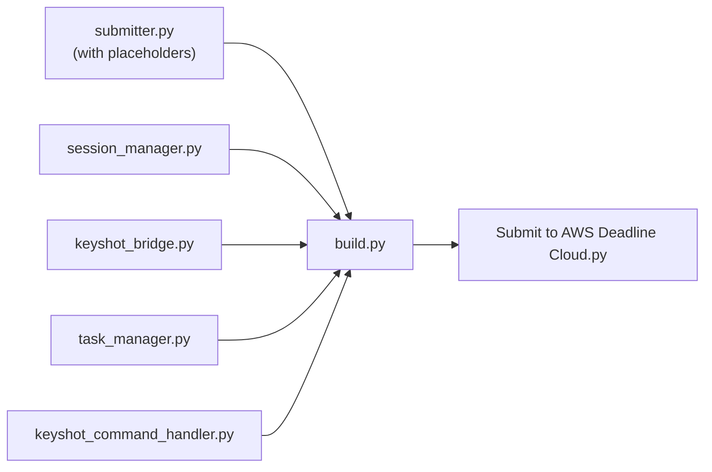
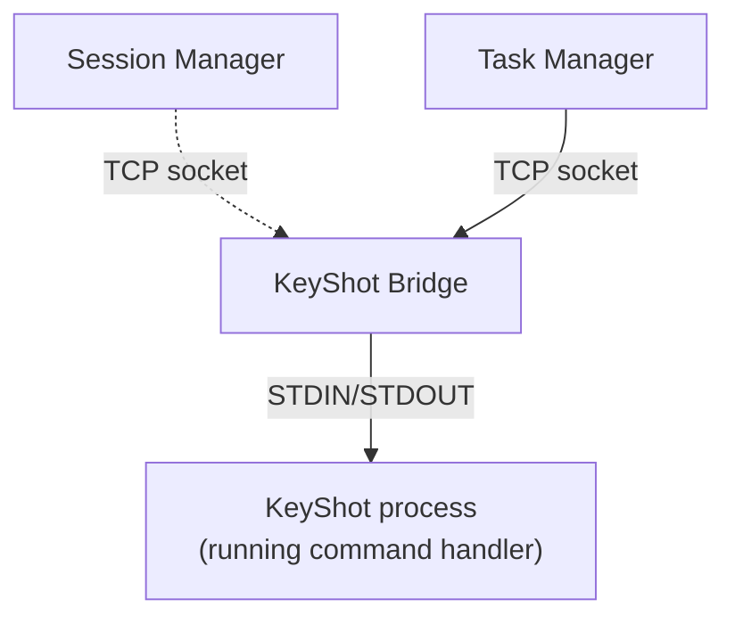

# KeyShot submitter

A KeyShot script that submits the open scene to AWS Deadline Cloud. The script packages the scene with its
assets and opens the Deadline Cloud submission dialog. The job it creates keeps one KeyShot process running
per worker session and sends each frame to it as a render command, so KeyShot starts once per session
instead of once per frame.

This sample is tested with KeyShot 2025.

## Prerequisites

* A Windows or macOS workstation with KeyShot Studio installed.
* The [Deadline Cloud CLI](https://docs.aws.amazon.com/deadline-cloud/latest/developerguide/submit-jobs-how.html)
  with GUI support, installed so that `deadline` is on your `PATH`:

  ```console
  pip install "deadline[gui]"
  ```

* Python 3.11 or later on the workstation to build the submitter script.
* A Deadline Cloud queue with Windows workers that can run KeyShot. See [Worker setup](#worker-setup).
* A KeyShot license for each worker that renders.

## Setup

1. Build the submitter from this directory. The build uses only the Python standard library:

   ```console
   python src/build.py --output "Submit to AWS Deadline Cloud.py"
   ```

2. Copy `Submit to AWS Deadline Cloud.py` to the KeyShot scripts folder:
   * Windows: `%USERPROFILE%\Documents\KeyShot Studio\Scripts` or `%PROGRAMFILES%\KeyShot Studio\Scripts`
   * macOS: `/Library/Application Support/KeyShot Studio/Scripts`

   You can also write the build output straight to the scripts folder by passing that path to `--output`.
   KeyShot picks up the new script without a restart.

3. In KeyShot Studio's preferences, under **General**, clear **Use local Python paths**. This prevents
   the submitter from importing Python libraries that KeyShot does not include.

## Submit a job

1. Open a scene in KeyShot Studio.
2. Choose **Window > Scripting Console > Scripts > Submit to AWS Deadline Cloud > Run**.
3. Choose which files to attach: the scene and all of its external file references, or only the scene's
   `.bip` file. Attach only the `.bip` file when workers read the referenced files from shared storage.
4. Review the job settings in the Deadline Cloud submission dialog, then choose **Submit**.

To attach external references, the submitter saves the scene as a KeyShot Package (`.ksp`) and unpacks it
so that job attachments upload the scene and every referenced file. It writes an OpenJD job bundle and runs
`deadline bundle gui-submit` on it. Job settings such as the conda channel are saved next to the scene in
a `.deadline_render_settings.json` file and reused the next time you submit that scene.

To write the job bundle to a directory without opening any dialogs, run the script from the command line.
Use this to inspect the generated bundle after you modify the submitter:

```console
"/Applications/KeyShot Studio.app/Contents/MacOS/keyshot" -headless scene.bip -script "Submit to AWS Deadline Cloud.py" --bundle ./bundle-output
deadline bundle submit ./bundle-output
```

## Worker setup

Workers need KeyShot Studio installed and licensed. The job finds the KeyShot executable in this order:
the `KEYSHOT_EXECUTABLE` environment variable, `%KEYSHOT_LOCATION%\bin\keyshot_headless.exe`, then
`keyshot_headless.exe` or `keyshot` on the `PATH`.

* **Service-managed fleets, or any queue with a conda queue environment:** build a KeyShot conda package with
  the [KeyShot 2025 conda recipe](../../../conda_recipes/keyshot-2025/) and host it in your own conda channel,
  such as an S3 bucket. Set the queue environment's `CondaChannels` default to that channel, or enter it in
  the submitter's job settings. The submitter requests `keyshot=<major version>.*` to match the version of
  KeyShot that submits the job.
* **Customer-managed fleets with KeyShot installed on the host:** set `KEYSHOT_EXECUTABLE` on the worker, or
  put the KeyShot install directory on the `PATH`, and clear the job's `CondaPackages` value.

The job uses TCP ports 9000-9099 on the loopback interface (127.0.0.1) to communicate between its scripts
and the KeyShot process. These ports do not need network access.

## How it works

`src/submitter.py` runs inside KeyShot's embedded Python interpreter and uses KeyShot's `lux` API to read
the scene and render settings. The job template it writes embeds four worker-side scripts as
`embeddedFiles`. `src/build.py` injects those scripts into placeholders in `submitter.py` to produce the
single-file submitter that KeyShot runs.



On the worker, the scripts keep a KeyShot process open for the session and feed it commands:



| Script | Runs in | When | What it does |
|---|---|---|---|
| `session_manager.py` | Worker Python | Step `onEnter` and `onExit` | Starts the bridge and waits for KeyShot to report ready. On exit, sends the stop command. |
| `keyshot_bridge.py` | Worker Python | Whole session | Starts KeyShot and forwards data between a TCP socket on the loopback interface and KeyShot's STDIN and STDOUT. |
| `keyshot_command_handler.py` | KeyShot's Python | Whole session | Reads newline-delimited JSON commands from STDIN and calls the `lux` API to render. |
| `task_manager.py` | Worker Python | Each task's `onRun` | Sends one frame's render command and converts KeyShot output into OpenJD progress, completion, and failure. |

The scripts exchange newline-delimited JSON commands. A render command looks like this:

```json
{
  "command": "render",
  "frame": 5,
  "output_path": "/path/to/output.png",
  "output_format": "PNG",
  "render_device": "GPU",
  "override_render_device": true,
  "render_options": {
    "engine_anti_aliasing": 1,
    "progressive_max_samples": 100
  }
}
```

The stop command is `{"command": "stop"}`.

## Submission hooks

The submitter runs the external `deadline` CLI, so Deadline Cloud
[submission hooks](https://github.com/aws-deadline/deadline-cloud/blob/mainline/docs/submission-hooks.md)
apply to its jobs with no submitter changes. Hooks require `deadline` 0.60.1 or later, and `deadline:` job
property overrides such as `deadline:priority` require 0.60.4 or later. Check the version with
`deadline --version`.

## Run the unit tests

The tests replace the `lux` module with a mock, so they run without KeyShot. Repository CI runs them on
every pull request:

```console
pip install pytest pytest-asyncio
python -m pytest test/unit
```

## Related resources

* [KeyShot 2025 conda recipe](../../../conda_recipes/keyshot-2025/) to build the worker package.
* [KeyShot standalone job bundle](../../keyshot_standalone/) for a static template that renders each frame
  as a separate KeyShot launch.
* [Submission hooks samples](../../../submission_hooks/) to customize jobs before submission.
